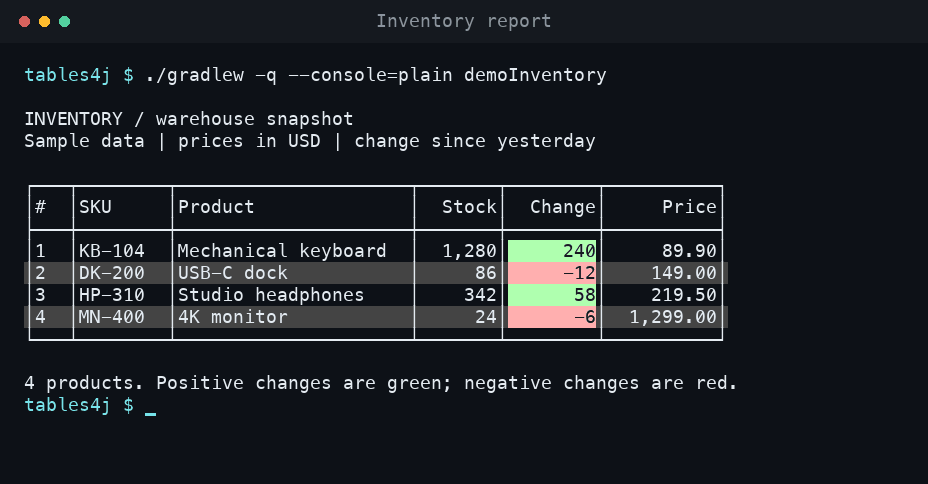
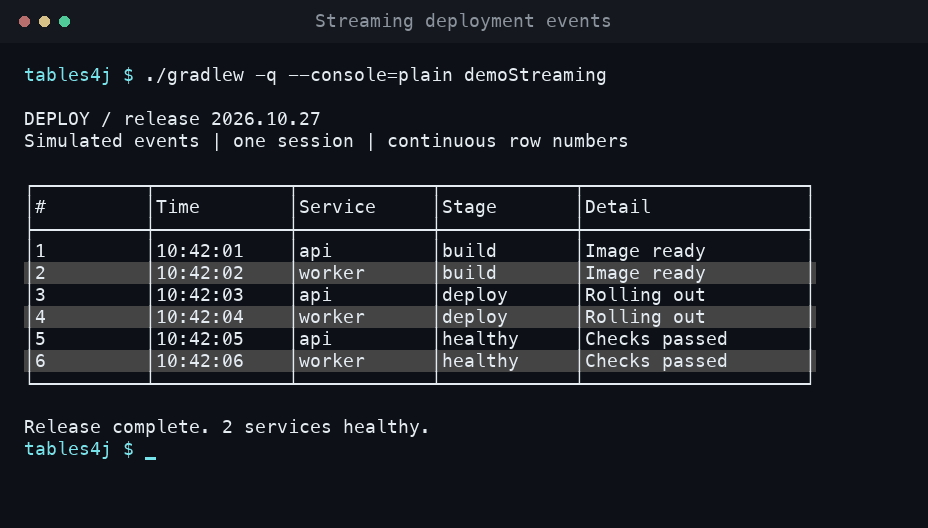
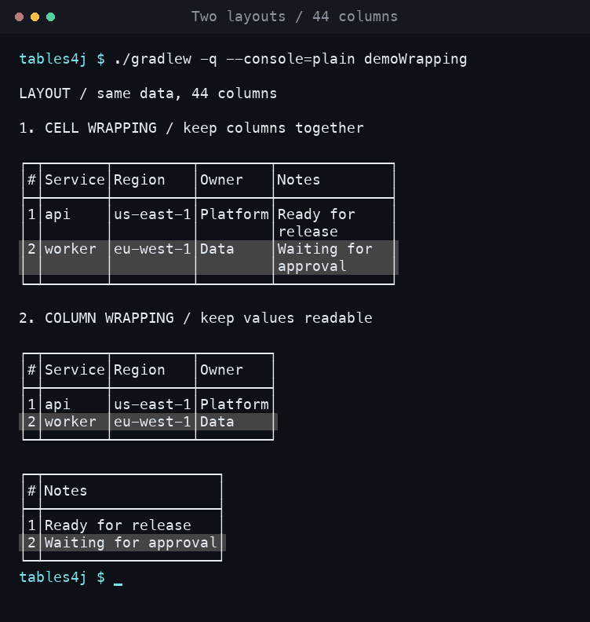

# tables4j

**Readable terminal tables from ordinary Java objects.**

Build inventory reports, command-line dashboards, and streaming event logs without
hand-aligning strings. Define your columns once, pass in your beans, and let tables4j
handle layout, formatting, and row numbering.

- **Reusable schemas.** Discover columns from bean getters, including nested objects.
- **Two layouts.** Wrap cell contents or split wide tables into groups of columns.
- **Useful formatting.** Named headers, decimal precision, alignment, thousands
  separators, and green/red backgrounds for signed values.
- **Streaming output.** Append batches with continuous row numbers and optional repeated headers.
- **Terminal awareness.** Detect the current dimensions or supply a fixed size.

[Demos](#see-it-in-action) · [Install](#build-and-install) · [Quick start](#quick-start) ·
[Formatting](#format-your-columns) · [Streaming](#append-rows-as-they-arrive)

## See it in action

These GIFs are recordings of the included Java CLIs running in a terminal. All data
is illustrative; the demos run locally without connecting to external services.
You need **Java 21**; the included Gradle wrapper handles the build.

### Inventory report

Annotated headers, right-aligned numbers, two decimal places, and signed color coding
in a single snapshot.



```sh
./gradlew -q --console=plain demoInventory
```

[Read the example →](examples/src/main/java/com/ilooner/tables4j/examples/InventoryCli.java)

### Streaming deployment log

Events arrive one at a time. A session appends each row to the same table and keeps
the numbering continuous. Fixed column minimums keep this example aligned between batches.



```sh
./gradlew -q --console=plain demoStreaming
```

[Read the example →](examples/src/main/java/com/ilooner/tables4j/examples/DeploymentCli.java)

### Narrow terminal layouts

The same data at a width of 44 characters: first with wrapped cell contents, then
with columns split into smaller tables. Column groups retain the row-number column.



```sh
./gradlew -q --console=plain demoWrapping
```

[Read the example →](examples/src/main/java/com/ilooner/tables4j/examples/WrappingCli.java)

## Build and install

Build with Java 21. No separate Gradle installation is needed:

```sh
./gradlew clean build
```

This runs the tests, compiles the examples, and generates the library, source, and
Javadoc JARs in `build/libs/`. The examples are separate from the published library.
On Windows, use `gradlew.bat` in place of `./gradlew`.

The Maven coordinates are `com.ilooner:tables4j:0.1.0`. Releases are published to
[GitHub Packages](https://github.com/ilooner/tables4j/packages) using the release
workflow described under [Publishing](#publishing).

### Download the JARs

Each [GitHub release](https://github.com/ilooner/tables4j/releases) includes these
downloads under **Assets** once its workflow completes:

- `tables4j-VERSION.jar` — the compiled library.
- `tables4j-VERSION-sources.jar` — the Java source.
- `tables4j-VERSION-javadoc.jar` — the API documentation.

The library JAR does not bundle its dependencies. Use the Maven or Gradle setup
below to resolve those dependencies automatically.

### Install from GitHub Packages

GitHub's Maven registry requires authentication even for public packages. Use a
personal access token **(classic)** with `read:packages` and access to this repository.
Keep credentials in your environment or your user-level `~/.gradle/gradle.properties`;
do not commit them. See [GitHub's authentication documentation](https://docs.github.com/en/packages/working-with-a-github-packages-registry/working-with-the-gradle-registry#authenticating-to-github-packages).

In a consuming Gradle project:

```groovy
repositories {
    mavenCentral()
    maven {
        url = uri('https://maven.pkg.github.com/ilooner/tables4j')
        credentials {
            username = providers.gradleProperty('gpr.user')
                .orElse(providers.environmentVariable('GITHUB_ACTOR')).orNull
            password = providers.gradleProperty('gpr.key')
                .orElse(providers.environmentVariable('GITHUB_TOKEN')).orNull
        }
        content {
            includeGroup 'com.ilooner'
        }
    }
}

dependencies {
    implementation 'com.ilooner:tables4j:0.1.0'
}
```

Set `GITHUB_ACTOR` to your GitHub username and `GITHUB_TOKEN` to your token, or use
the `gpr.user` and `gpr.key` properties in your user-level Gradle configuration.

For Maven, add the repository and dependency to your `pom.xml`:

```xml
<repositories>
    <repository>
        <id>github</id>
        <url>https://maven.pkg.github.com/ilooner/tables4j</url>
    </repository>
</repositories>

<dependencies>
    <dependency>
        <groupId>com.ilooner</groupId>
        <artifactId>tables4j</artifactId>
        <version>0.1.0</version>
    </dependency>
</dependencies>
```

Add a server with the matching ID to your user-level `~/.m2/settings.xml`, using
the same environment variables:

```xml
<settings>
    <servers>
        <server>
            <id>github</id>
            <username>${env.GITHUB_ACTOR}</username>
            <password>${env.GITHUB_TOKEN}</password>
        </server>
    </servers>
</settings>
```

### Install a local checkout

To use an unpublished checkout in another local project without GitHub credentials,
publish it to your local Maven repository:

```sh
./gradlew publishToMavenLocal
```

Then add it to a Java 21+ Gradle project:

```groovy
repositories {
    mavenLocal()
    mavenCentral()
}

dependencies {
    implementation 'com.ilooner:tables4j:0.1.0'
}
```

For Maven, after the same local publication step, add this dependency to your POM:

```xml
<dependency>
    <groupId>com.ilooner</groupId>
    <artifactId>tables4j</artifactId>
    <version>0.1.0</version>
</dependency>
```

## Quick start

Create a bean, discover its columns, and render a list. This complete example uses
a fixed width so its layout is predictable:

```java
import com.ilooner.tables4j.AsciiTableColumn;
import com.ilooner.tables4j.RenderOptions;
import com.ilooner.tables4j.TableRenderer;
import com.ilooner.tables4j.TableSchema;
import java.util.List;

public class Example {
    public static final class Task {
        @AsciiTableColumn(name = "Task", minimumWidth = 18)
        private final String name;

        @AsciiTableColumn(name = "Attempts", minimumWidth = 8)
        private final int attempts;

        public Task(String name, int attempts) {
            this.name = name;
            this.attempts = attempts;
        }

        public String getName() { return name; }
        public int getAttempts() { return attempts; }
    }

    public static void main(String[] args) {
        var schema = TableSchema.from(Task.class);
        var renderer = TableRenderer.forWidth(80, RenderOptions.cellWrapping());
        var tasks = List.of(new Task("Import orders", 1), new Task("Send receipts", 3));

        System.out.println(renderer.render(schema, tasks));
    }
}
```

Schemas inspect **declared instance fields with public `getX()` or boolean `isX()`
getters**. Static fields and fields without a matching getter are skipped. Use
ordinary beans with these getters; Java record accessors such as `name()` are not
discovered automatically. Null cell values render as empty cells.

Keep a schema around and reuse it for later renders. Rendering a snapshot does not
modify the schema or your rows.

## Format your columns

Place `@AsciiTableColumn` on a bean's **field**:

```java
@AsciiTableColumn(
    name = "Change",
    decimalPlaces = 2,
    alignment = AsciiTableColumn.Alignment.RIGHT,
    colorCode = true,
    minimumWidth = 12,
    padding = 2
)
private final BigDecimal change;
```

| Option | Default | Effect |
| --- | --- | --- |
| `name` | Field name | Changes the column header. |
| `decimalPlaces` | `-1` | Sets the scale of `BigDecimal` values with half-up rounding; `-1` uses default formatting. |
| `alignment` | `DEFAULT` | Uses the type's default alignment, or explicitly selects `LEFT` or `RIGHT`. |
| `colorCode` | `false` | Gives positive values a light green background and negative values a light red background; zero is unchanged. |
| `minimumWidth` | `0` | Sets the minimum column width in character cells. |
| `padding` | `0` | Adds width before the table is fitted to the available space. |

Numbers use thousands separators. `BigDecimal` values omit trailing zeros unless
you specify `decimalPlaces`. Joda Money `BigMoney` values render right-aligned with
two decimal places, without a currency symbol; `CurrencyUnit` renders its currency
code. Joda Time `DateTime` values use the machine's default time zone. Other values
use their string representation.

Bean tables include a `#` column and alternating row backgrounds automatically.

### Nested beans

Use the expanded discovery strategy to turn child properties into columns:

```java
var schema = TableSchema.from(Order.class, ColumnDiscovery.EXPAND_CHILD_OBJECTS);
```

For example, an `Order` with a `customer` bean containing `name` and `city` fields
produces headers such as `customer.name` and `customer.city`. Both levels need
public bean getters. Leaf types stay in a single column, cycles stop expansion,
and a null child produces empty cells for its discovered columns.

## Choose a layout and terminal size

```java
// Keep columns together; wrap long values within their cells.
var compact = TableRenderer.forWidth(60, RenderOptions.cellWrapping());

// Split columns into groups, keeping the row number in each group.
var grouped = TableRenderer.forWidth(60, RenderOptions.columnWrapping());

// Detect dimensions for each render and repeat headers based on terminal height.
var automatic = TableRenderer.forTerminal(RenderOptions.cellWrapping());
```

You can set renderer-wide sizing preferences:

```java
var options = RenderOptions.cellWrapping()
    .withMinimumColumnWidth(8)
    .withColumnWidthPadding(2)
    .withMinimumRowNumberWidth(4)
    .withTerminalHeight(24);
```

`RenderOptions` is immutable; each `with...` method returns a new value. A fixed-width
renderer repeats headers only when you explicitly set a terminal height. Widths are
measured in character cells; configured minimums and table borders can require more
space than a very narrow terminal provides.

Automatic detection checks, in order, the `tables4j.terminalWidth` and
`tables4j.terminalHeight` system properties, the `COLUMNS` and `LINES` environment
variables, and `stty`. It falls back to **80 × 24**. For custom size detection or
tests, pass a `TerminalSizeProvider` to the constructor:

```java
var renderer = new TableRenderer(
    () -> new TerminalSize(100, 30),
    RenderOptions.cellWrapping()
);
```

## Append rows as they arrive

With the `Task` bean from the quick start:

```java
var schema = TableSchema.from(Task.class);
var renderer = TableRenderer.forWidth(80, RenderOptions.cellWrapping());
var session = renderer.openSession(schema, System.out);

session.append(List.of(new Task("Import orders", 1)));
// Later, when another batch arrives:
session.append(List.of(new Task("Send receipts", 3)));
```

The first nonempty batch prints the headers. Subsequent batches append with
continuous row numbering; empty batches do nothing. Use each session from one
thread at a time. The session leaves your output stream open.

Layout is recalculated for every batch. Set column minimum widths large enough for
the expected values when you need stable alignment, as the deployment demo does.
Keep unrelated log messages out of the session's output stream between appends:
appending uses cursor controls to replace the previous table's bottom border.

Output includes ANSI styling, and sessions also use ANSI cursor controls. Use an
ANSI-capable terminal to see the intended output; redirected files contain those
escape sequences.

## Render a manually built table

Already using `de.vandermeer.asciitable.AsciiTable`? Render it directly:

```java
var table = new AsciiTable();
table.addRule();
table.addRow("Service", "Status");
table.addRule();
table.addRow("api", "healthy");
table.addRule();

var renderer = TableRenderer.forWidth(60, RenderOptions.cellWrapping());
System.out.println(renderer.render(table));
```

The renderer adapts the table without mutating the caller's table. The AsciiTable
dependency is exposed through the library's public API.

## Development

```sh
./gradlew clean build --warning-mode all   # Tests, examples, and all JARs
./gradlew test                            # Tests only
./gradlew javadoc                         # API docs in build/docs/javadoc/
./gradlew tasks --group examples          # List the demo CLIs
```

To run the animated demos without pauses, add `-PdemoDelay=0` to their Gradle command.
The default delay between deployment events is 900 ms.

## Publishing

The [publishing workflow](.github/workflows/publish.yml) runs when a GitHub release
is **published**. It checks out that release's tag, uses Java 21, checks the tag
against `build.gradle`, runs the tests, and builds the library, source, and Javadoc
JARs. It attaches all three JARs to the release's **Assets**, then publishes the Maven
package to `https://maven.pkg.github.com/ilooner/tables4j`. Each JAR includes the
Apache 2.0 license. Ordinary commits, tags without a published release, and draft
releases do not publish packages.

To publish the first version:

1. Commit and push this publishing configuration to `main`.
2. Confirm `version = '0.1.0'` in `build.gradle`, then run:

   ```sh
   ./gradlew verifyReleaseVersion clean build -PreleaseTag=v0.1.0 --warning-mode all
   ```

3. In the repository's **Releases** page, create and publish a release with tag
   **`v0.1.0`**, targeting the commit containing this configuration.
4. Check the **Publish release** run in **Actions**. After it succeeds, all three
   JARs are downloadable from the release's **Assets**, and
   `com.ilooner:tables4j:0.1.0` is available in the repository's **Packages** section.

The workflow uses the automatically supplied `GITHUB_TOKEN` with `contents: write`
to attach release assets and `packages: write` to publish the Maven package. No
personal publishing token or additional repository secret is needed. Repository or
organization policy must allow GitHub Actions and package publishing.

For subsequent releases, update the version in `build.gradle` and the README examples,
and use a matching `vVERSION` tag. Treat published versions as immutable: publish a
new version for changes instead of rerunning a successful upload of the same version.

### Attach binaries to an existing release

To repair a release such as `v0.1.0` that has no JAR downloads:

1. Push the updated workflow to `main`.
2. Open **Actions → Publish release → Run workflow** and select the `main` branch.
3. Enter `v0.1.0` as **release_tag**, then run the workflow.

The manual run builds the code at the selected **tag**, attaches only missing JARs,
and skips Maven publication so an already-published package version is not uploaded
again. Existing release assets are preserved. Use this new manual run to pick up
the updated workflow; rerunning an older workflow run uses its original workflow.

### Publish the Maven package from your machine

To publish directly from your machine, configure `GITHUB_ACTOR` and `GITHUB_TOKEN`
(or `gpr.user` and `gpr.key`) with a classic token that has `write:packages` and write
access to this repository, then run:

```sh
./gradlew publishMavenJavaPublicationToGitHubPackagesRepository -PreleaseTag=v0.1.0
```

The direct publishing task also runs checks before upload. Build, test, and local
Maven publication continue to work without GitHub credentials. This Gradle command
publishes only to the Maven registry; use the workflow to attach GitHub release assets.

<details>
<summary>Regenerate the terminal recordings and GIFs</summary>

The recorder runs the actual Gradle demo commands in a pseudoterminal, saves their
output and timing as [asciicast v2](https://docs.asciinema.org/manual/asciicast/v2/)
files in [`docs/recordings/`](docs/recordings/), and renders the terminal state with
pyte and Pillow into [`docs/media/`](docs/media/). It preserves the library's ANSI
colors and cursor movement.

On macOS or Linux with Bash, Java 21, and Python 3.10+:

```sh
python3 -m venv build/recording-venv
build/recording-venv/bin/pip install -r scripts/recording-requirements.txt
build/recording-venv/bin/python scripts/record-demos.py
```

The script detects Menlo, DejaVu Sans Mono, or Liberation Mono. To use another
monospace font, pass `--font /path/to/font.ttf`. Python dependencies are only needed
to regenerate the GIFs, not to build or use the Java library.

</details>

## License

Licensed under the [Apache License, Version 2.0](LICENSE) (SPDX: `Apache-2.0`).

Third-party dependencies and the Gradle wrapper retain their original licenses and notices.
